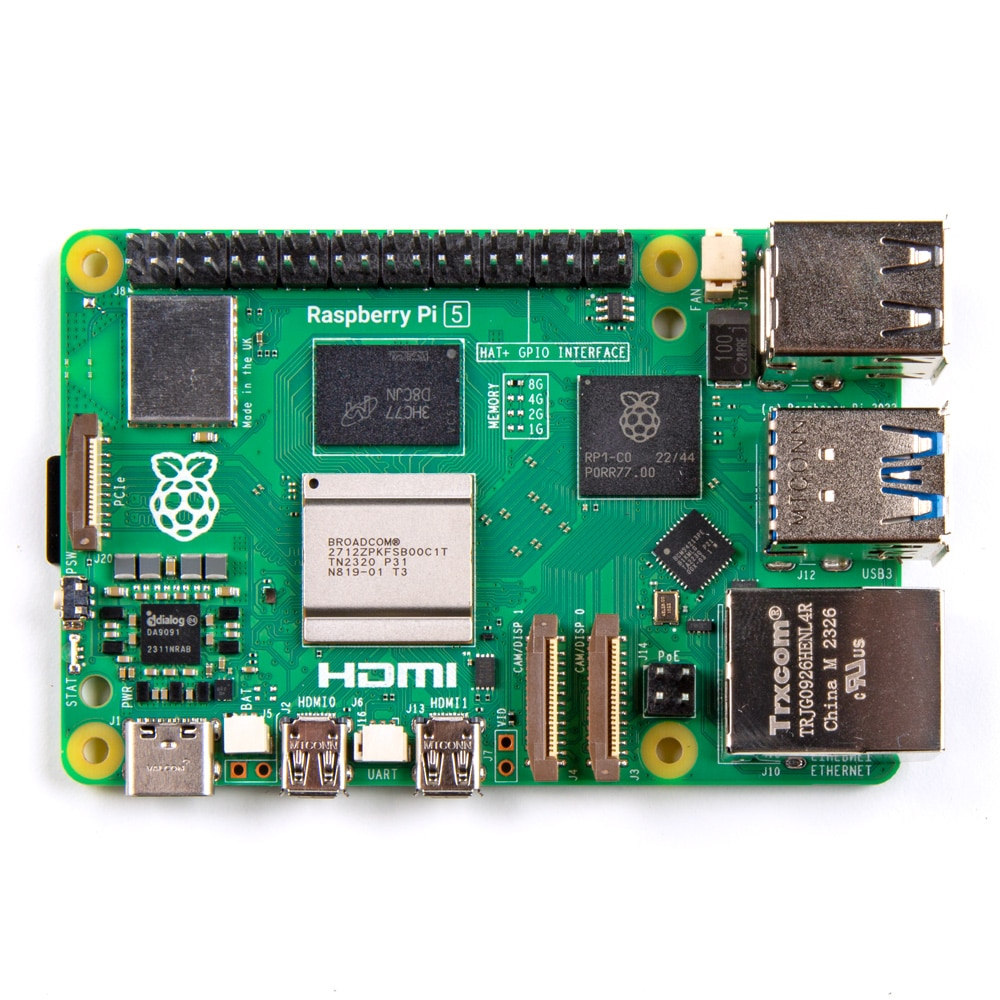
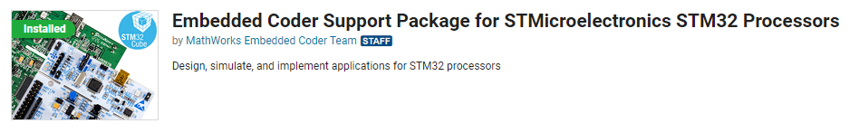
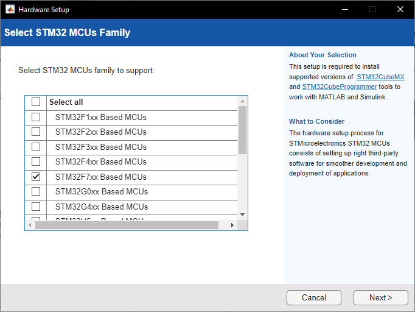
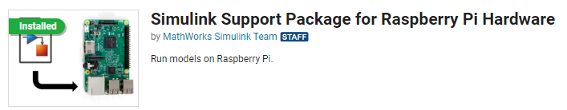
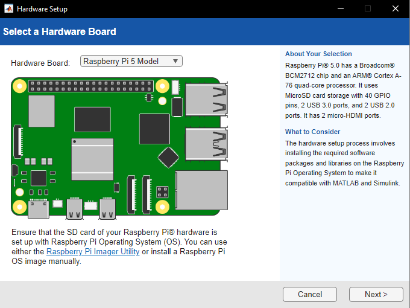

# Guía 1: Instalación del entorno

## Objetivo

Esta etapa deja instaladas las herramientas necesarias para usar la simulación PIL en las dos plataformas de este trabajo: la **STM32 Nucleo F767ZI** y la **Raspberry Pi 5**. Primero se instalan las herramientas comunes entre ambas, y luego lo específico de cada placa. Al finalizar esta guía se busca que el computador reconozca las dos placas y quede listo para las guías siguientes.

| | |
| :---: | :---: |
| { width="450" }| { width="200" } |
| *Raspberry Pi 5* | *STM32 Nucleo F767ZI* |

*Figura 1: Plataformas utilizadas en este trabajo.*

## Contexto

Primero que nada, para usar una simulación PIL hay que preparar cinco elementos:

1. Los productos de MathWorks que generan el código C desde Simulink.
2. Un compilador de C en el computador.
3. Un paquete de soporte para la placa.
4. Una toolchain que compila ese código para el procesador de la placa.
5. Las herramientas propias de cada placa: el sistema operativo en la Raspberry Pi y STM32CubeMX en la STM32, que se instala con el paquete de soporte aunque no se usa en estas guías.

Los dos primeros elementos tienen una instalación comun para cualquier placa; los tres últimos dependen de una instalación especifica ([Requerimientos de Embedded Coder](https://www.mathworks.com/support/requirements/embedded-coder.html)).

Salvo MATLAB, las herramientas (1)-(3) se instalan desde el Add-On Explorer de MATLAB. Para revisar lo ya instalado, se verifica en **Home > Add-Ons > Manage Add-Ons**.

## Instalación común

### 1) Productos de MathWorks
A continuación se instalarán las herramientas proporcionadas por el propio MathWorks.
La Tabla 1 lista los productos necesarios para ambas plataformas.

*Tabla 1: Productos de MathWorks requeridos.*

| Producto        | Para qué sirve                                       |
| ---------------- | --------------------------------------------------  |
| MATLAB           | Entorno base.                                       |
| Simulink         | Entorno para simular y modelar.                     |
| MATLAB Coder     | Genera código C y C++ a partir de código MATLAB.    |
| Simulink Coder   | Genera el código C desde bloques en Simulink.       |
| Embedded Coder   | Genera código para sistemas embebidos y habilita simulaciones SIL/PIL.               |
| Control System Toolbox (opcional) | Modelar, analizar y sintonizar sistemas de control.|

### 2) Compilador de C

Embedded Coder también requiere un compilador de C en el computador, aparte de la toolchain de cada placa. Este compilador se usa en las simulaciones SIL, cuyo código se compila y ejecuta en el computador; en PIL, el código para el procesador de la placa lo compila la toolchain. La lista de compiladores compatibles para Windows está en [Compiladores Soportados](https://www.mathworks.com/support/requirements/supported-compilers.html).

Por conveniencia, se utilizará el compilador MinGW para estas guías, ([Link MinGW de Matlab](https://la.mathworks.com/matlabcentral/fileexchange/52848-matlab-support-for-mingw-w64-c-c-fortran-compiler)).

{ width="700" }

## Instalación específica: STM32 Nucleo F767ZI

### 3) Paquete de soporte para STM32

El soporte para STM32 se instala como un complemento aparte. Este es su nombre en R2025b, la versión usada en estas guías:

- Embedded Coder Support Package for STMicroelectronics STM32 Processors.
La familia STM32F7xx, a la que pertenece la STM32 Nucleo F767ZI, tiene soporte, por lo que su configuración es más fácil. (Si la placa no tiene soporte, se puede realizar la simulación PIL, pero antes hay que configurar los pines de comunicación en STM32CubeMX.) ([Link Embedded Coder](https://www.mathworks.com/matlabcentral/fileexchange/43093))

{ width="900" }

### 4) Toolchain para STM32

La toolchain de la STM32 es **GNU Tools for ARM Embedded Processors**. La instala el asistente *Hardware Setup* del paquete de soporte, que se abre desde el **Add-On Manager** (**Home > Add-Ons > Manage Add-Ons**) con el botón **Setup**.

En la pantalla *Select STM32 MCUs Family*, marca **STM32F7xx Based MCUs**, la familia a la que pertenece la STM32 Nucleo F767ZI.

{ width="600" style="display:block; margin:0 auto" }

Sigue los pasos del asistente hasta terminar. En la pantalla de instalación de herramientas de terceros, presiona **Install** y acepta los permisos de administrador si los pide.

### 5) Herramientas propias de la STM32

La herramienta propia de esta placa es **STM32CubeMX**, que genera el código de inicialización de los periféricos. Viene con el asistente *Hardware Setup* del paquete de soporte, en la misma ventana donde se instala la toolchain.

{ width="400" style="display:block; margin:0 auto" }

STM32CubeMX se instala, pero no se usa en las simulaciones de estas guías: como la STM32 Nucleo F767ZI tiene soporte, el puerto serial se configura directamente en Simulink.

## Instalación específica: Raspberry Pi 5

### Antes de empezar: sistema operativo

La herramienta propia de esta placa es su **sistema operativo**, que debe estar escrito en la tarjeta SD con Raspberry Pi Imager ([Instalador Pi Imager](https://www.raspberrypi.com/software/)).

Este es el único elemento que se instala antes que el paquete de soporte, porque el asistente de hardware necesita conectarse a una placa que ya esté funcionando.

### 3) Paquete de soporte para Raspberry Pi

El soporte para Raspberry Pi se instala como un complemento aparte. Este es su nombre en R2025b, la versión usada en estas guías:

- Simulink Support Package for Raspberry Pi Hardware.
Permite ejecutar modelos de Simulink en la Raspberry Pi. ([Link Support Raspberry Pi](https://www.mathworks.com/matlabcentral/fileexchange/40313-simulink-support-package-for-raspberry-pi-hardware))

{ width="700" }

Una vez instalado, abre su asistente *Hardware Setup* desde el **Add-On Manager** (**Home > Add-Ons > Manage Add-Ons**) con el botón **Setup**. En **Hardware Board**, selecciona *Raspberry Pi 5 Model* y sigue los pasos del asistente hasta terminar. La placa debe estar encendida, con el sistema operativo ya escrito en la tarjeta SD y, por conveniencia, en la misma red que el computador.

{ width="600" style="display:block; margin:0 auto" }

### 4) Toolchain para Raspberry Pi 5

La toolchain que usa PIL con la Raspberry Pi es **GNU GCC Embedded Linux**. Igual que en la STM32, se descarga con el asistente *Hardware Setup* del paquete de soporte, que además instala en la placa las dependencias necesarias. En el modelo solo se selecciona, como se indica en la Guía 1.2.

## Validación

Si ambos asistentes terminaron sin errores, queda comprobar que el computador reconoce cada placa:

- **STM32:** conecta la placa por USB y revisa que aparezca como puerto COM en el Administrador de dispositivos, en *Puertos (COM y LPT)*.
- **Raspberry Pi:** ejecuta `raspberrypi` en la Command Window. Debe devolver los datos de la conexión con la placa.

Con esto, el entorno está listo. La siguiente guia ayuda con el tema de configurar cada placa para la simulación de PIL.