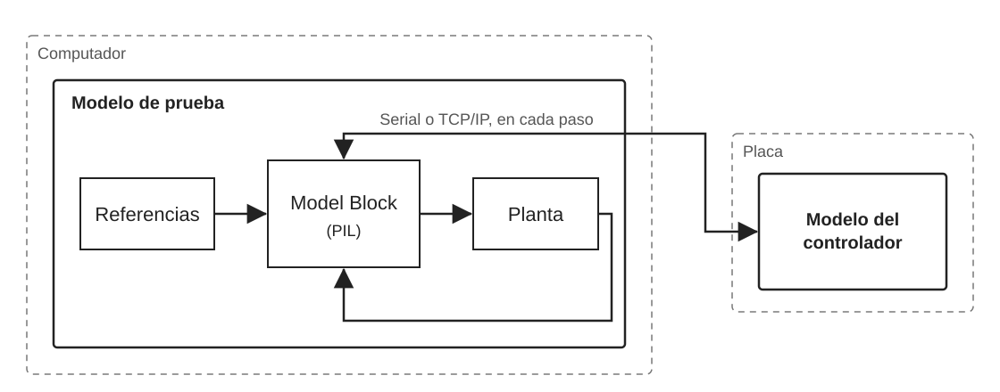
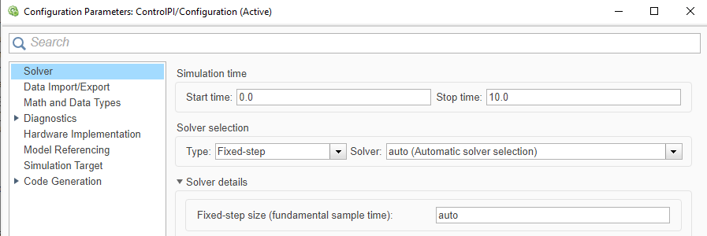
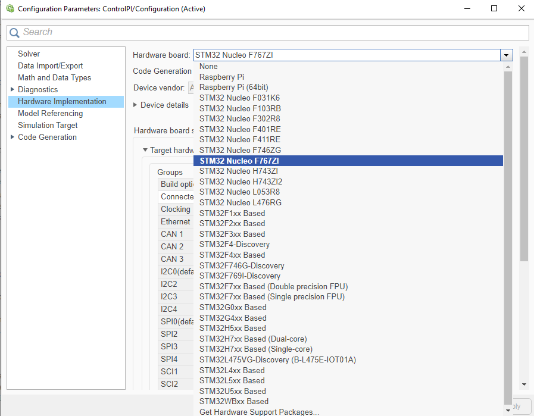
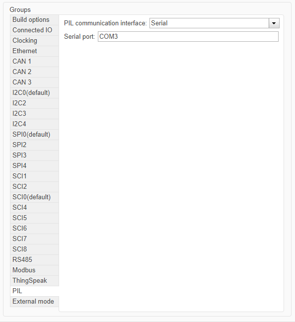
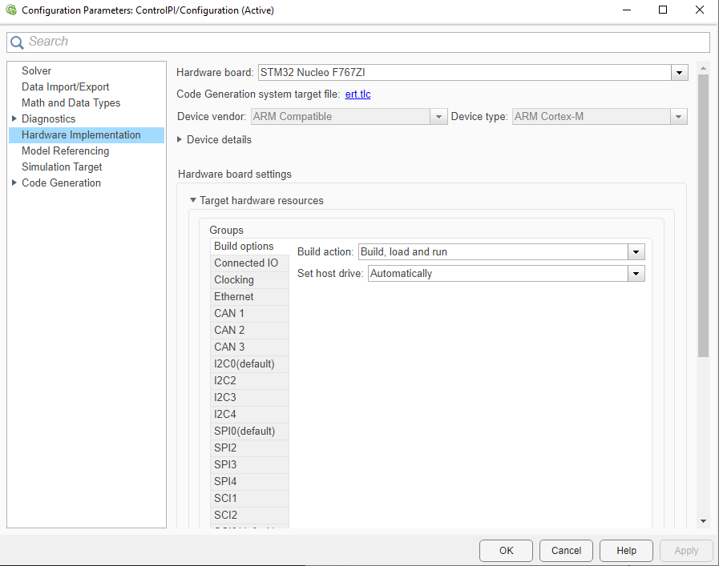
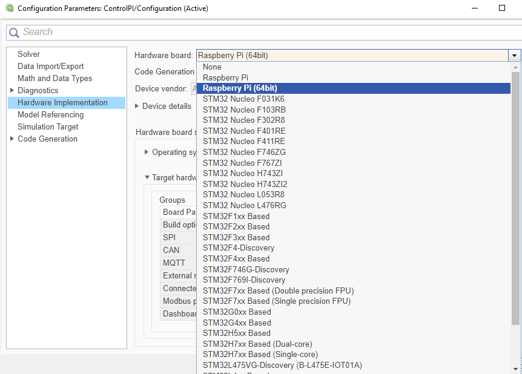
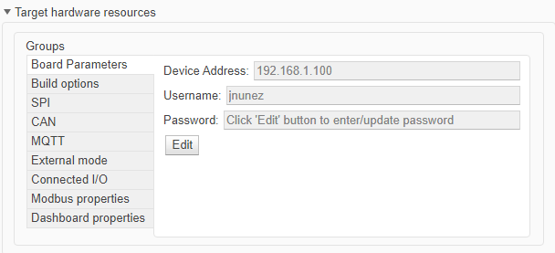
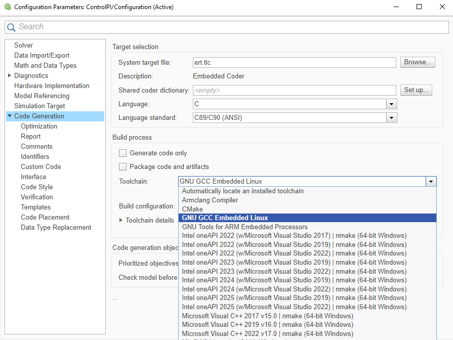

# Guía 2: Configuración de las plataformas para PIL
 
## Objetivo
 
Para esta etapa se configura el modelo de Simulink para ejecutar PIL en la **STM32 Nucleo F767ZI** y en la **Raspberry Pi 5**. La configuración se hace una sola vez por modelo e indica para qué placa y con qué herramientas se genera el código, y cómo se comunica con el computador.
 
## Contexto

En las posteriores guias, la simulación PIL usa el bloque **Model**, que permite incluir un modelo de Simulink dentro de otro ([Model](https://www.mathworks.com/help/simulink/slref/model.html)). Por eso cada ejemplo tiene dos modelos, como muestra la Figura 1:

- El **modelo de prueba** contiene las referencias, la planta y un bloque Model que llama al modelo del controlador. Es el modelo más grande y se simula en el computador.
- El **modelo del controlador** contiene solo el controlador. Es el modelo más pequeño y es el que se ejecuta en la placa.

En cada paso de la simulación, el bloque Model envía a la placa las entradas del controlador y recibe sus salidas, por un puerto serial o por la red.

**Cabe recalcar que ambos modelos deben configurarse como se indica en esta guía.**

*Figura 1: Esquema del modelo de prueba en el computador y del modelo del controlador en la placa.*

## Configuración del modelo

Con las herramientas de la Guía 1 instaladas, falta indicarle a Simulink con qué placa trabajar y cómo conectarse a ella. Esa información se ingresa en el cuadro **Configuration Parameters** del modelo, que se abre con Ctrl+E.

Cada modelo tiene su propio cuadro Configuration Parameters, así que la configuración de esta guía se aplica en los dos: solver de paso fijo, la misma placa, la misma comunicación, `ert.tlc` y la misma toolchain. Además, el modelo del controlador necesita algunas opciones propias, que se indican en cada guía.

Lo que cambia entre las plataformas es el canal de comunicación: la STM32 usa un puerto serial y la Raspberry Pi usa la red (TCP/IP). Estas guías solo cubren placas con soporte, como la STM32 Nucleo F767ZI, que se configuran directamente en Simulink. Las placas STM32 sin soporte tienen otra opción de configuración, mediante un proyecto de STM32CubeMX, que no se aborda aquí ([Configure STM32 Boards using STM32CubeMX with Simulink](https://www.mathworks.com/help/releases/R2025b/ecoder/stmicroelectronicsstm32f4discovery/ug/STM32-CubeMX-Configuration.html)).

## Paso previo: solver del modelo
 
Para generar y verificar código, el modelo debe usar un solver de paso fijo, porque el código generado solo admite ese tipo de solver. El solver se deja en automático, para que Simulink lo elija según el modelo.
 
En **Configuration Parameters**, sección **Solver**, se configura:
 
*Tabla 1: Configuración del solver.*
 
| Parámetro       | Valor                             |
| --------------- | --------------------------------- |
| Type            | `Fixed-step`                      |
| Solver          | `auto (Automatic solver selection)` |
| Fixed-step size | `auto`                            |

 
**Fixed-step size** se deja en `auto`, su valor por defecto, que elige un paso que cubra todos los tiempos de muestreo del modelo ([Fixed-step size](https://www.mathworks.com/help/simulink/gui/fixedstepsizefundamentalsampletime.html)).
 

*Figura 2: Sección Solver de Configuration Parameters.*
 
## Configuración 1: STM32 con soporte
 
Es el caso de la STM32 Nucleo F767ZI: Simulink la reconoce por nombre, por lo que solo hay que elegir la placa, indicar cómo se comunica con el computador y seleccionar las opciones de generación de código. Todo se hace en **Configuration Parameters**: las dos primeras en la sección **Hardware Implementation** y la última en **Code Generation**.
 
### Paso 1: Seleccionar la placa
 
Lo primero es indicar para qué placa se generará el código. Despliega **Hardware Implementation > Hardware board** y selecciona *STM32 Nucleo F767ZI*. Al elegirla, aparecen debajo los parámetros propios de la placa, entre ellos **Target hardware resources**, que se usa en el paso siguiente.
 

*Figura 3: Selección de la STM32 Nucleo F767ZI en Hardware board.*
 
### Paso 2: Configurar la comunicación
 
En PIL, el modelo se comunica con la placa por un puerto serial: el computador ve la placa como un puerto COM, y el modelo necesita saber cuál es.
 
Conecta la placa con un cable Micro USB y anota su puerto COM en el Administrador de dispositivos, en *Puertos (COM y LPT)*. Luego, en **Hardware Implementation > Target hardware resources**, entra a la pestaña **PIL**. En **PIL communication interface**, elige **Serial** y, en **Serial port**, escribe el COM anotado.
 

*Figura 4: Pestaña PIL de la STM32.*
 
Indica también el mismo COM en la pestaña **External mode**.
 
### Paso 3: Seleccionar el System target file y la toolchain
 
Para poder usar PIL, en **Code Generation > System target file** selecciona `ert.tlc`, que corresponde a Embedded Coder.
 
La toolchain es el compilador que Simulink usa para construir el código generado. En **Code Generation > Toolchain**, selecciona **GNU Tools for ARM Embedded Processors**, la que instaló el asistente en la Guía 1.
 

*Figura 5: ert.tlc como System target file de la STM32.*
 
## Configuración 2: Raspberry Pi 5
 
La Raspberry Pi 5 es un computador con Linux, por lo que no se configuran periféricos ni pines. Simulink se conecta a ella por red, usando la dirección y las credenciales de su Linux, y esos datos se ingresan en la configuración del modelo ([Model Configuration Simulink Support Package for Raspberry Pi Hardware](https://www.mathworks.com/help/releases/R2025b/simulink/supportpkg/raspberrypi_ref/raspberrypi-model-configuration-parameters.html)). La placa debe estar encendida y, por conveniencia, en la misma red que el computador. Aquí también se parte con el solver del paso previo.
 
### Paso 1: Seleccionar la placa
 
Igual que en la STM32, se indica para qué placa se genera el código. En **Hardware Implementation > Hardware board**, selecciona *Raspberry Pi (64bit)*. Esto carga los parámetros por defecto de la placa, que se completan en el paso siguiente.
 

*Figura 6: Selección de Raspberry Pi (64bit) en Hardware board.*
 
### Paso 2: Completar los parámetros de conexión
 
Con la placa seleccionada aparecen sus parámetros. Para que Simulink se comunique con la Raspberry hay que modificar tres de ellos, en **Target hardware resources > Board Parameters**, con el botón **Edit**. Con estos datos queda configurada indirectamente la comunicación por TCP/IP.
 
*Tabla 2: Parámetros de conexión con la Raspberry Pi.*
 
| Parámetro | Valor |
| --- | --- |
| Device Address | Dirección IP o nombre de host de la placa. |
| Username | Usuario de Linux de la placa. |
| Password | Contraseña de ese usuario. |
 

*Figura 7: Parámetros de conexión de la Raspberry Pi.*
 
### Paso 3: Seleccionar el System target file y la toolchain
 
Igual que en la STM32, en **Code Generation > System target file** selecciona `ert.tlc`. En **Code Generation > Toolchain**, selecciona **GNU GCC Embedded Linux**.
 

*Figura 8: System target file y toolchain de la Raspberry Pi.*
 
## Validación
 
Si el modelo tiene el solver de paso fijo, la placa seleccionada, los parámetros de comunicación completos, `ert.tlc` como System target file y la toolchain de la placa seleccionada, la configuración está lista. Guarda el modelo. Cuando se trabaja con dos modelos, como en las Guías 3 y 4, esta revisión se hace en ambos.
