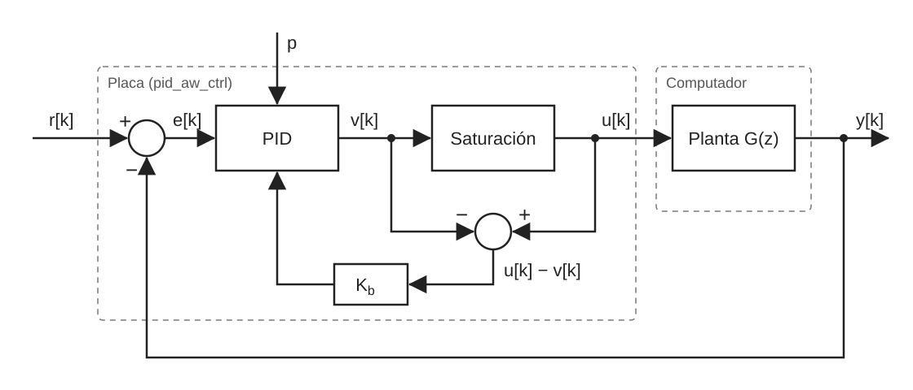
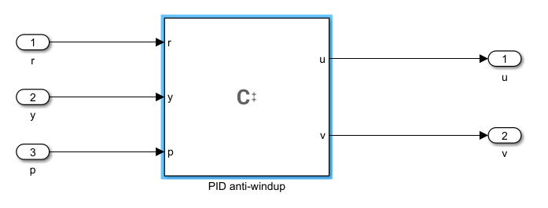
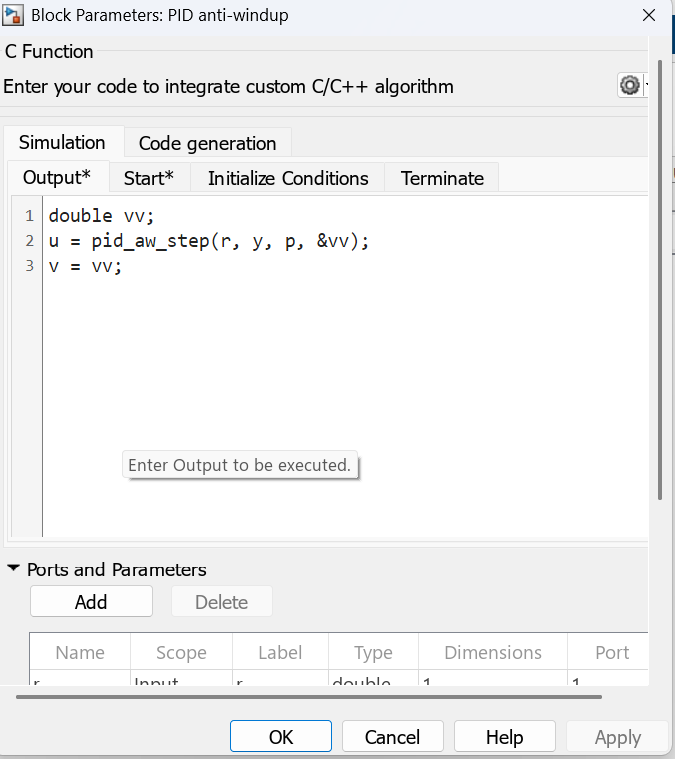
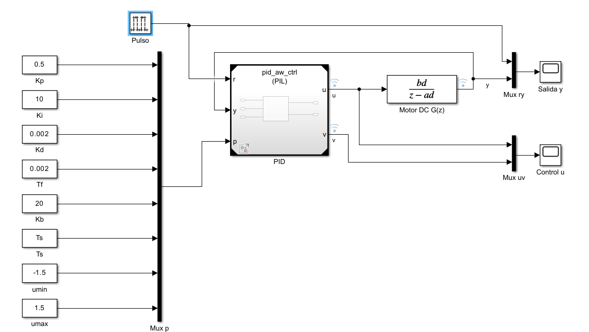
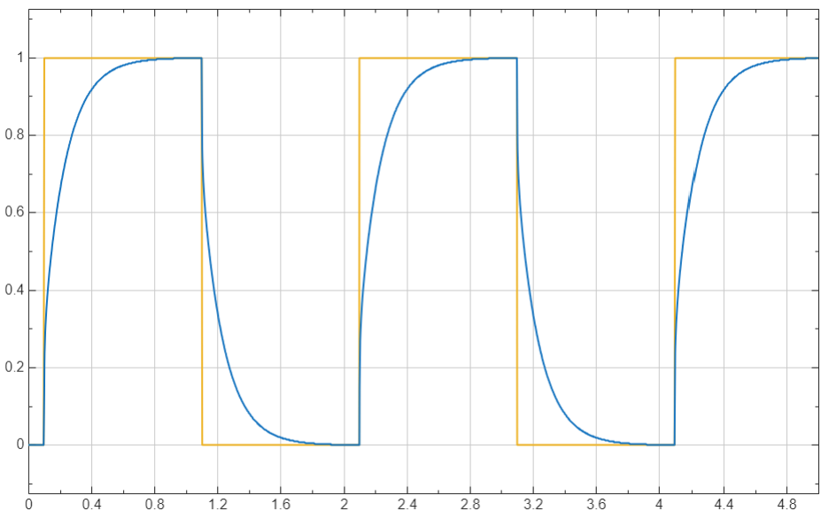
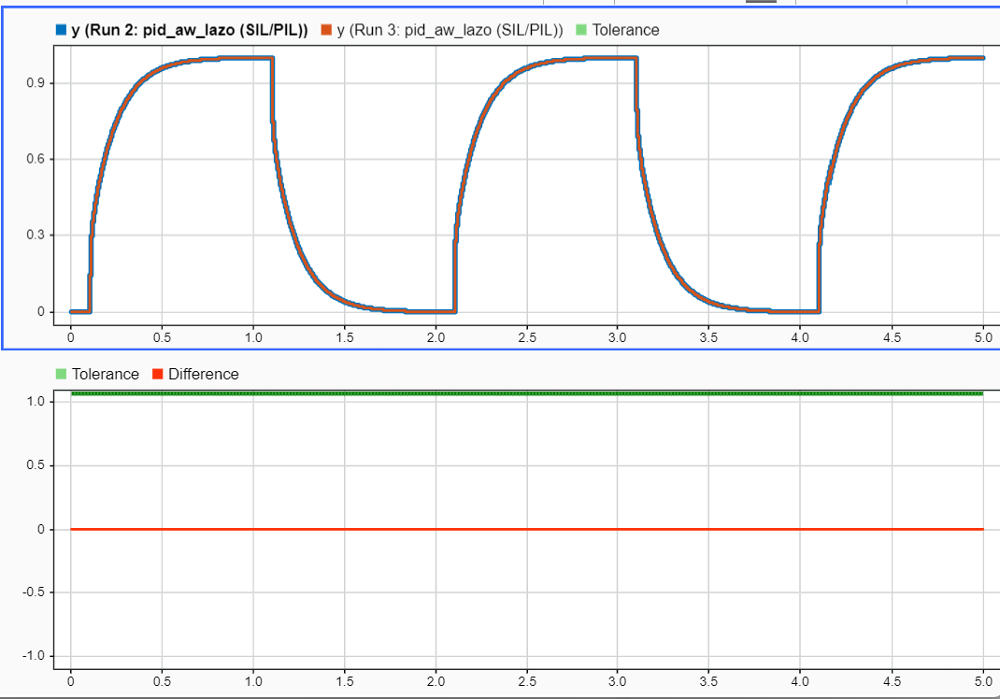

# Guía 3: Controlador PID con anti-windup con PIL en STM32 Nucleo F767ZI

## Objetivo

En esta guía el lector implementa un controlador PID discreto con anti-windup, escrito en C, y lo ejecuta en la STM32 Nucleo F767ZI mediante PIL. Luego verifica que el código ejecutado en la placa reproduce la simulación en el computador.

## Contexto

La guía utiliza PIL mediante el bloque Model de Simulink. En modo PIL, el bloque Model genera código del modelo referenciado, lo compila para la plataforma objetivo y lo ejecuta en ella ([Model](https://www.mathworks.com/help/simulink/slref/model.html)). Durante la simulación, el computador y la placa intercambian datos en cada paso de tiempo.

La guía usa dos modelos de Simulink. El modelo del controlador, `pid_aw_ctrl.slx`, se ejecuta en la placa. El modelo de prueba, `pid_aw_lazo.slx`, contiene la planta y se ejecuta en el computador. El controlador recibe la referencia y la medición por separado y calcula el error dentro de la placa.



*Figura 1: Partición del lazo de control con anti-windup en la simulación PIL.*

El controlador se escribe en C y se integra con un bloque C Function, que permite llamar código externo desde un modelo y generar código a partir de él ([C Function](https://www.mathworks.com/help/simulink/slref/cfunction.html)).

## Caso de estudio

### Planta

La planta es un sistema de primer orden con ganancia unitaria y constante de tiempo $\tau = 10\ \text{ms}$, que aproxima un motor DC. El periodo de muestreo es $T_s = 1\ \text{ms}$. Discretizada con retenedor de orden cero, su función de transferencia es la Ecuación 1.

$$
G(z) = \frac{b_d}{z - a_d}, \quad a_d = e^{-T_s/\tau} = 0.9048, \quad b_d = 1 - a_d = 0.0952 \tag{1}
$$

### El problema del windup

Todo actuador tiene un límite. Cuando el controlador pide más de lo que el actuador puede entregar, la señal que llega a la planta queda fija en ese límite, pero el integrador sigue acumulando el error. Su estado crece sin que eso tenga efecto sobre la planta. Cuando la referencia cambia, el controlador primero debe descargar lo acumulado, y por eso la respuesta se retrasa. A este fenómeno se le llama windup.

### Controlador

El controlador es un PID paralelo con derivada filtrada, saturación y anti-windup por back-calculation. Este método realimenta al integrador la diferencia entre la señal saturada y la señal sin saturar ([Discrete PID Controller](https://www.mathworks.com/help/simulink/slref/discretepidcontroller.html)). En tiempo continuo, el controlador y su integrador se describen con la Ecuación 2.

$$
C(s) = K_p + \frac{K_i}{s} + \frac{K_d\, s}{T_f s + 1}, \quad \dot{I} = K_i e + K_b (u - v) \tag{2}
$$

Aquí $v$ es la señal de control sin saturar, $u$ es la señal saturada que llega a la planta y $K_b$ es la ganancia de anti-windup. Su inverso, $1/K_b$, es la constante de tiempo con que el integrador se descarga. Mientras no hay saturación, $u = v$, el término de anti-windup vale cero y el controlador se comporta como un PID normal.

Al discretizar con Forward Euler se obtienen las Ecuaciones 3 a 7, donde $x_f$ es el estado del filtro de la derivada.

$$
e[k] = r[k] - y[k] \tag{3}
$$

$$
v[k] = K_p\, e[k] + I[k] + \frac{K_d}{T_f}\left(e[k] - x_f[k]\right) \tag{4}
$$

$$
u[k] = \min\left(\max\left(v[k],\ u_{min}\right),\ u_{max}\right) \tag{5}
$$

$$
I[k+1] = I[k] + T_s \left(K_i\, e[k] + K_b \left(u[k] - v[k]\right)\right) \tag{6}
$$

$$
x_f[k+1] = x_f[k] + \frac{T_s}{T_f}\left(e[k] - x_f[k]\right) \tag{7}
$$

## Paso 1: Definir los parámetros del controlador

Los parámetros no se escriben dentro del controlador. Se entregan como un vector de 8 elementos que entra por un puerto del modelo, con el orden de la Tabla 1. Como sus valores viajan desde el computador en cada paso, cambiarlos no modifica el código que corre en la placa.

*Tabla 1: Vector de parámetros p.*

| Elemento | Parámetro | Valor | Descripción |
| -------- | --------- | ----- | ------------------------------- |
| p[0]     | Kp        | 0.5   | Ganancia proporcional           |
| p[1]     | Ki        | 10    | Ganancia integral               |
| p[2]     | Kd        | 0.002 | Ganancia derivativa             |
| p[3]     | Tf        | 0.002 | Constante del filtro derivativo |
| p[4]     | Kb        | 20    | Ganancia de anti-windup         |
| p[5]     | Ts        | Ts    | Periodo de muestreo             |
| p[6]     | umin      | -1.5  | Límite inferior de la señal     |
| p[7]     | umax      | 1.5   | Límite superior de la señal     |

El periodo de muestreo y los coeficientes de la planta se definen como variables del workspace. Para que se carguen al abrir los modelos, se escriben en el callback PreLoadFcn de cada uno: `Ts` y `tau`, con los valores del caso de estudio, y `ad` y `bd`, calculados como en la Ecuación 1.

## Paso 2: Crear el modelo del controlador

Cree una carpeta de trabajo y escriba en ella el código del controlador, en los archivos `pid_aw.c` y `pid_aw.h`. El código tiene dos funciones:

- `pid_aw_init` deja en cero los estados $I$ y $x_f$.
- `pid_aw_step` recibe $r$, $y$ y el vector `p`, calcula las Ecuaciones 3 a 5 y actualiza los estados con las Ecuaciones 6 y 7. Devuelve $u$ y entrega $v$ mediante un puntero.

Los estados se guardan como variables estáticas, para que conserven su valor entre una llamada y la siguiente.

El archivo `pid_aw.h` declara las funciones:

```c
#ifndef PID_AW_H
#define PID_AW_H

void   pid_aw_init(void);                                     /* estados en cero: I = 0, xf = 0                */
double pid_aw_step(double r, double y, const double *p,double*v);                                /* devuelve u_sat[k]; *v = u[k] sin saturar      */
#endif
```

El archivo `pid_aw.c` las implementa:

```c
#include "pid_aw.h"

static double I  = 0.0;   /* integrador          I[k]   */
static double xf = 0.0;   /* filtro derivativo   xf[k]  */

void pid_aw_init(void)
{
    I  = 0.0;
    xf = 0.0;
}

double pid_aw_step(double r, double y, const double *p, double *v)
{
    const double Kp = p[0], Ki = p[1], Kd = p[2], Tf = p[3];
    const double Kb = p[4], Ts = p[5], umin = p[6], umax = p[7];

    /* 1) error */
    const double e = r - y;

    /* 2) salida con los estados en k:  D[k] = Kd/Tf (e[k] - xf[k]),  u[k] = Kp e[k] + I[k] + D[k] */
    const double D = (Kd / Tf) * (e - xf);
    const double u = Kp * e + I + D;

    /* 3) saturacion */
    double us = u;
    if (us > umax) us = umax;
    if (us < umin) us = umin;

    /* 4) actualizacion Forward Euler de los estados a k+1 */
    I  = I  + Ts * (Ki * e + Kb * (us - u));     /* back-calculation      */
    xf = xf + (Ts / Tf) * (e - xf);              /* filtro de la derivada */

    *v = u;
    return us;
}
```

Dentro de `pid_aw_step`, la variable `u` es la señal sin saturar y `us` la saturada. En el modelo, y en las Ecuaciones 4 y 5, $v$ es la señal sin saturar y $u$ la saturada.

Cree un modelo nuevo llamado `pid_aw_ctrl.slx` en la misma carpeta. Tiene tres entradas, `r`, `y` y `p`, conectadas a un bloque C Function, y dos salidas, `u` y `v`, como muestra la Figura 2. La entrada `p` es un vector de 8 elementos y todo el modelo trabaja con el periodo `Ts`.



*Figura 2: Modelo del controlador pid_aw_ctrl.*

El bloque C Function conecta el modelo con el código en C. Al inicio llama a `pid_aw_init` y en cada paso llama a `pid_aw_step`. Estas llamadas se escriben tanto en la sección de simulación como en la de generación de código del bloque. La ubicación del código propio se deja en Configuration Parameters, porque los archivos se indican en el Paso 3.



*Figura 3: Configuración del bloque C Function.*

## Paso 3: Configurar el modelo del controlador

Configure el solver, la placa, el System target file y la toolchain como se explica en la [Guía 2](../Guia_2_Configuracion/Guia_2.md). Este controlador necesita además las opciones de la Tabla 2, en Model Configuration Parameters.

*Tabla 2: Configuración adicional del modelo pid_aw_ctrl.*

| Panel                                           | Parámetro                                       | Valor                 |
| ----------------------------------------------- | ----------------------------------------------- | --------------------- |
| Model Referencing                               | Total number of instances allowed per top model | One                   |
| Model Referencing                               | Include custom code for referenced models       | Marcado               |
| Simulation Target y Code Generation > Custom Code | Include headers                               | `#include "pid_aw.h"` |
| Simulation Target y Code Generation > Custom Code | Include directories                           | Carpeta de trabajo    |
| Simulation Target y Code Generation > Custom Code | Source files                                  | Ruta de `pid_aw.c`    |

El código propio se indica dos veces porque Simulation Target lo usa al simular en el computador y Custom Code lo usa al generar el código para la placa.


## Paso 4: Configurar la comunicación

En cada paso, el computador envía a la placa la referencia $r[k]$, la medición $y[k]$ y el vector de parámetros, y recibe de vuelta las señales $u[k]$ y $v[k]$ (Figura 1). Este intercambio ocurre por el puerto serial.

Configure el puerto como se explica en la Guía 2: en **Hardware Implementation > Target hardware resources > PIL**, elija **Serial** en **PIL communication interface** y escriba en Serial port el COM de la placa. Indique también ese COM en la pestaña External mode.

## Paso 5: Crear el modelo de prueba

Cree el modelo `pid_aw_lazo.slx` en la misma carpeta, con los parámetros del Paso 1, cada uno en un bloque Constant, y utilice la configuración de la Guía 2. No necesita las opciones de la Tabla 2. La Figura 4 muestra el lazo cerrado que contiene.

Un generador de pulsos entrega la referencia, que sube a 1 y vuelve a 0 de forma periódica. Un grupo de constantes guarda los valores de la Tabla 1 y los reúne en el vector `p`. El bloque Model llama al controlador `pid_aw_ctrl`, que recibe la referencia, la medición y ese vector. La señal saturada $u$ entra a la planta de la Ecuación 1, y su salida $y$ vuelve al controlador como medición. Dos Scope muestran la respuesta del lazo y las señales de control, y las señales $u$, $v$ e $y$ quedan registradas para revisarlas en el Simulation Data Inspector.



*Figura 4: Modelo de prueba pid_aw_lazo.*

## Paso 6: Ejecutar la simulación PIL

Configure el bloque Model en modo PIL:

1. Haga clic derecho sobre el bloque y seleccione Block Parameters.
2. En Simulation mode, seleccione Processor-in-the-loop (PIL).
3. En Code interface, seleccione Model reference.
4. Presione OK.

El bloque muestra la etiqueta (PIL) en su ícono.

Conecte la placa y presione Run. Simulink genera el código del controlador, lo compila junto con `pid_aw.c`, lo descarga a la placa y abre la comunicación por el puerto serial.



*Figura 5: Respuesta del lazo en la simulación PIL.*

## Paso 7: Verificar la equivalencia numérica

Como el controlador admite una sola instancia, no se pueden tener dos lazos en paralelo con el mismo controlador. La comparación se hace con dos ejecuciones del mismo modelo:

1. Ejecute la simulación en modo PIL, como en el Paso 6.
2. Cambie el Simulation mode del bloque Model a Normal y ejecute de nuevo.
3. Abra el Simulation Data Inspector y compare ambas ejecuciones en las señales $u$, $v$ e $y$.

Si el código ejecutado en la placa reproduce la simulación, la diferencia entre ambas ejecuciones es cero o muy pequeña. En las pruebas de este trabajo, la diferencia máxima en $u$, $v$ e $y$ fue cero.



*Figura 6: Comparación de las ejecuciones PIL y Normal.*

Al completar esta guía, el lector cuenta con un controlador PID con anti-windup escrito en C y verificado en la STM32 Nucleo F767ZI mediante PIL.