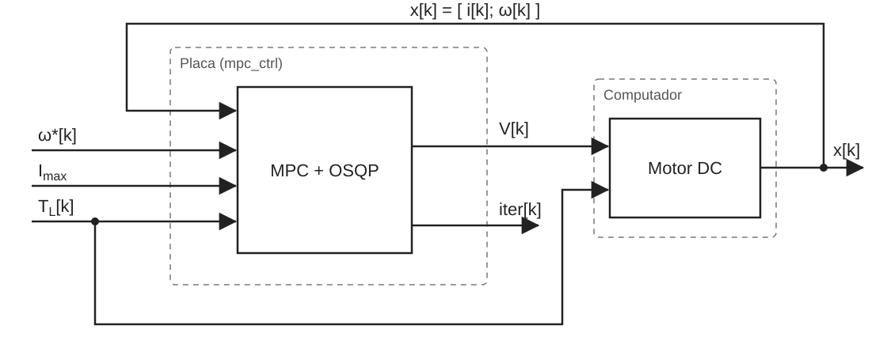
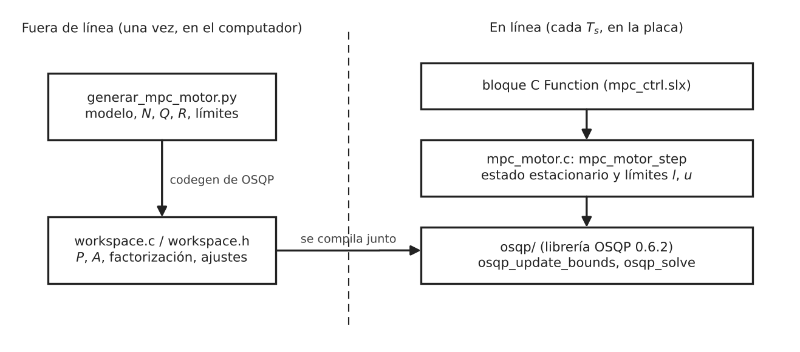
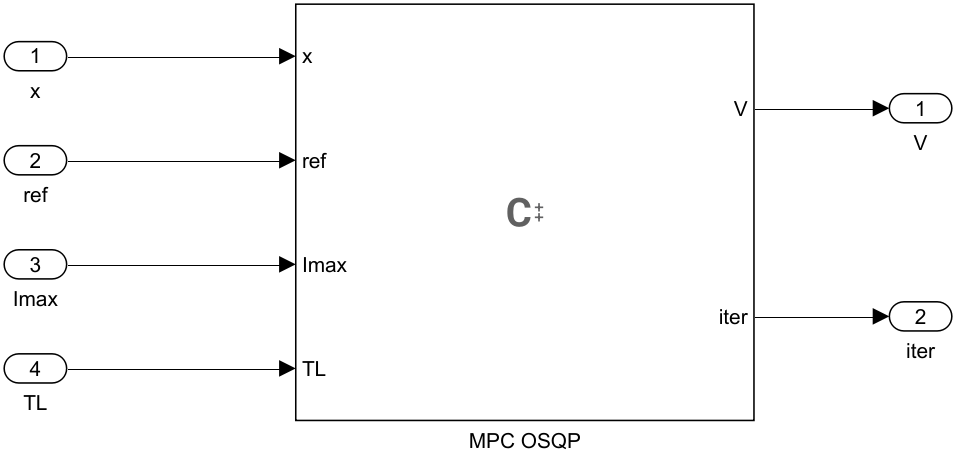
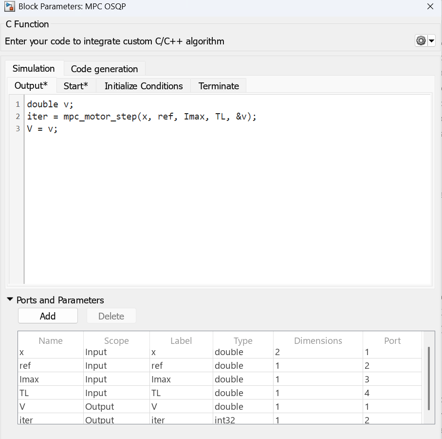
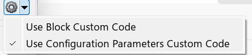
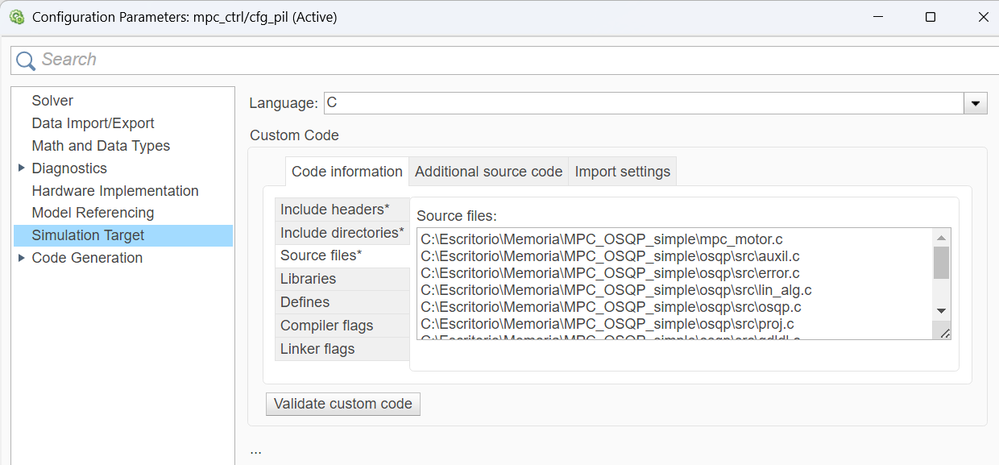
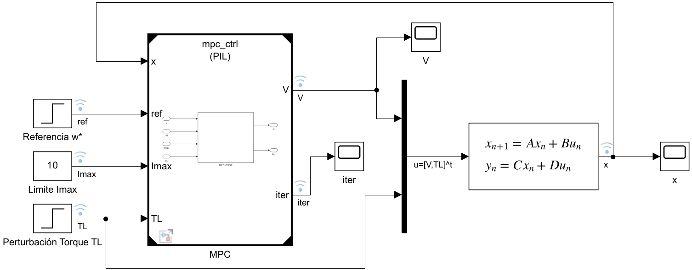
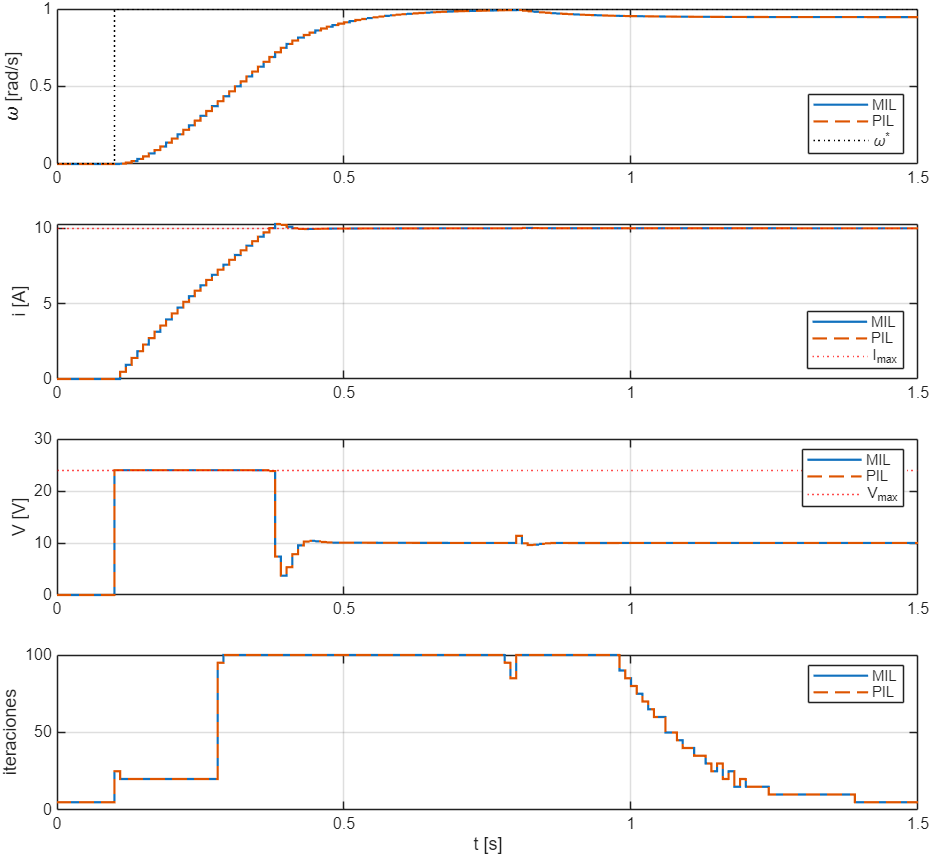
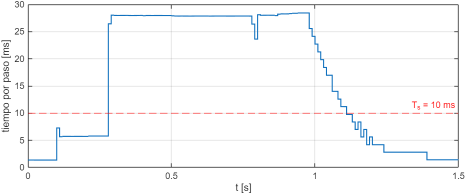

# Guía 4: Controlador predictivo (MPC) con PIL en STM32 Nucleo F767ZI

## Objetivo

En esta guía el lector ejecuta un controlador predictivo basado en modelo (MPC) en la STM32 Nucleo F767ZI mediante PIL. El MPC no existe como un bloque de Simulink que se configura con unos pocos parámetros: en cada periodo de muestreo resuelve un problema de optimización, y para eso necesita un solver numérico escrito en C. La guía muestra cómo integrar ese código en un modelo de Simulink, cómo ejecutarlo en la placa y cómo verificar que entrega los mismos resultados que la simulación en el computador. Al final se mide cuánto tarda la placa en calcular cada acción de control, que es el dato que permite decidir si el controlador puede funcionar en tiempo real.

## Contexto

Un MPC calcula la acción de control resolviendo, en cada instante de muestreo, un problema de optimización. Con el estado medido de la planta, el controlador predice la evolución del sistema durante un horizonte de $N$ pasos y busca la secuencia de entradas que minimiza un costo, respetando los límites de las entradas y de los estados. De esa secuencia solo aplica la primera entrada. En el siguiente instante mide de nuevo el estado y repite el cálculo. Este procedimiento se llama horizonte deslizante ([OSQP, Model predictive control](https://osqp.org/docs/examples/mpc.html)).

Cuando el modelo de la planta es lineal, el costo es cuadrático y las restricciones son lineales, el problema que se resuelve en cada paso es un programa cuadrático (QP). Para resolverlo se usa OSQP, un solver de código abierto para QP convexos basado en el método ADMM. OSQP resuelve problemas de la forma de la Ecuación 1.

$$
\begin{aligned}
\min_{z} \quad & \tfrac{1}{2} z^\top P z + q^\top z \\
\text{sujeto a} \quad & l \le A z \le u
\end{aligned} \tag{1}
$$

OSQP puede generar código C a la medida de un problema, sin asignación dinámica de memoria y sin dependencias de otras librerías, lo que permite compilarlo para un microcontrolador. El código de esta guía usa OSQP 0.6.2 y proviene del repositorio TiempoMPC.

El controlador completo, es decir, la preparación del problema y la llamada a OSQP, está escrito en C y se integra con un bloque C Function, igual que en la Guía 3. Así, el mismo código C se ejecuta en el computador durante la simulación normal y en la placa durante la simulación PIL.

La simulación PIL usa el bloque Model. En modo PIL, el bloque Model genera código del modelo referenciado, lo compila para la placa y lo ejecuta en ella. La Figura 1 muestra la partición del lazo. El MPC, dentro del modelo `mpc_ctrl.slx`, corre en la STM32 Nucleo F767ZI. La planta, las referencias y la perturbación, dentro del modelo `lazo.slx`, corren en el computador. En cada paso, el computador envía a la placa el estado medido y las entradas del controlador, y la placa devuelve la tensión que se aplica al motor y el número de iteraciones del solver.



*Figura 1: Partición del lazo de control en la simulación PIL del MPC.*

## Caso de estudio

### Planta

La planta es un motor DC con control de velocidad. La Ecuación 2 describe la parte eléctrica y la parte mecánica del motor.

$$
\begin{aligned}
L \frac{di}{dt} &= -R\, i - K \omega + V \\
J \frac{d\omega}{dt} &= K\, i - b\, \omega - T_L
\end{aligned} \tag{2}
$$

Los estados son la corriente de armadura $i$ y la velocidad angular $\omega$, por lo que $x = [\,i;\ \omega\,]$. La entrada manipulada es la tensión $V$ y la perturbación es el torque de carga $T_L$. Los parámetros son $J = 0.01\ \text{kg}\cdot\text{m}^2$, $b = 0.1\ \text{N}\cdot\text{m}\cdot\text{s}$, $K = 0.01\ \text{N}\cdot\text{m/A}$, $R = 1\ \Omega$ y $L = 0.5\ \text{H}$.

El MPC trabaja en tiempo discreto con un periodo de muestreo $T_s = 10\ \text{ms}$. El modelo de la Ecuación 2 se discretiza con retenedor de orden cero (ZOH), lo que entrega la Ecuación 3.

$$
x[k+1] = A_d\, x[k] + B_d\, V[k] + B_{p,d}\, T_L[k] \tag{3}
$$

$$
A_d = \begin{bmatrix} 0.9802 & -1.884\cdot 10^{-4} \\ 0.0094 & 0.9048 \end{bmatrix}, \quad
B_d = \begin{bmatrix} 0.0198 \\ 9.610\cdot 10^{-5} \end{bmatrix}, \quad
B_{p,d} = \begin{bmatrix} 9.610\cdot 10^{-5} \\ -0.9516 \end{bmatrix}
$$

### Controlador

El objetivo del controlador es que $\omega$ siga una referencia $\omega^*$. Para eso, el MPC primero calcula el punto de equilibrio en que el motor gira a la velocidad pedida. Igualando a cero las derivadas de la Ecuación 2 con $\omega = \omega^*$ se obtiene la Ecuación 4.

$$
\begin{aligned}
\omega_\infty &= \omega^* \\
i_\infty &= \frac{b\, \omega^* + T_L}{K} \\
V_\infty &= R\, i_\infty + K \omega^*
\end{aligned} \tag{4}
$$

El problema de optimización se escribe en variables de desviación respecto de ese equilibrio, $\tilde{x} = x - x_\infty$ y $\tilde{V} = V - V_\infty$. Así, llevar $\omega$ a la referencia equivale a llevar $\tilde{x}$ a cero. En cada paso, el MPC resuelve el problema de la Ecuación 5.

$$
\begin{aligned}
\min_{\tilde{x},\, \tilde{V}} \quad & \sum_{k=0}^{N-1} \left( \tilde{x}_k^\top Q\, \tilde{x}_k + R_V\, \tilde{V}_k^2 \right) + \tilde{x}_N^\top P_N\, \tilde{x}_N \\
\text{sujeto a} \quad & \tilde{x}_{k+1} = A_d\, \tilde{x}_k + B_d\, \tilde{V}_k \\
& \tilde{x}_0 = x[k] - x_\infty \\
& -I_{max} \le \tilde{i}_k + i_\infty \le I_{max}, \qquad k = 1, \dots, N \\
& -V_{max} \le \tilde{V}_k + V_\infty \le V_{max}, \qquad k = 0, \dots, N-1
\end{aligned} \tag{5}
$$

La Tabla 1 resume los parámetros del controlador. El peso $Q$ penaliza mucho más el error de velocidad que el de corriente, porque el objetivo es seguir la referencia de velocidad. El costo terminal $P_N$ se obtiene de la ecuación algebraica de Riccati discreta, que es una elección habitual para el último paso del horizonte.

*Tabla 1: Parámetros del MPC.*

| Parámetro | Valor | Significado |
| --- | --- | --- |
| $T_s$ | 10 ms | Periodo de muestreo |
| $N$ | 10 | Horizonte de predicción (0.1 s) |
| $Q$ | diag(0.01, 1000) | Peso sobre el error de $i$ y de $\omega$ |
| $R_V$ | 0.01 | Peso sobre la tensión |
| $P_N$ | solución de la ecuación de Riccati | Costo terminal |
| $V_{max}$ | 24 V | Límite de tensión |
| $I_{max}$ | 10 A | Límite de corriente (entrada del bloque) |

Para que OSQP pueda resolver la Ecuación 5, todas las incógnitas se agrupan en un solo vector $z = [\tilde{x}_0, \dots, \tilde{x}_{10}, \tilde{V}_0, \dots, \tilde{V}_9]$, de 32 elementos. La dinámica y los límites quedan como las 42 filas de la restricción $l \le Az \le u$ de la Ecuación 1: 22 filas de igualdad para la condición inicial y la dinámica, 10 filas para la corriente y 10 para la tensión. Las matrices $P$ y $A$ dependen solo del modelo y de los pesos, por lo que no cambian durante la operación. Lo único que cambia en cada paso son los vectores $l$ y $u$, porque dependen del estado medido, de la referencia, de $I_{max}$ y de $T_L$. Esta propiedad es la que permite que el problema se prepare una sola vez en el computador y que la placa solo actualice dos vectores en cada paso.

## Paso 1: Obtener los archivos del controlador

Descargue la carpeta `mpc_osqp` del [repositorio de las guías](https://github.com/julianNT/Ejemplos-uso-de-PIL). La Tabla 2 describe su contenido.

*Tabla 2: Archivos del controlador MPC.*

| Archivo | Qué es |
| --- | --- |
| `osqp/` | Librería OSQP 0.6.2 en C, copiada del repositorio [TiempoMPC](https://github.com/manuelsimonv/TiempoMPC). |
| `osqp/src/workspace.c` y `osqp/include/workspace.h` | El problema QP del motor ya armado: matrices $P$ y $A$, su factorización y los ajustes del solver. Se generan con el script de Python. |
| `mpc_motor.c` y `mpc_motor.h` | La función `mpc_motor_step`, que en cada paso prepara el problema, llama a OSQP y entrega la tensión. |
| `generar_mpc_motor.py` | Script que arma el QP a partir del modelo y de los parámetros, y genera `workspace.c` y `workspace.h`. |
| `mpc_ctrl.slx` | Modelo terminado del controlador. Contiene un bloque C Function. Es lo que se ejecuta en la placa. |
| `lazo.slx` | Modelo terminado de prueba, con la planta, las referencias y el bloque Model. |
| `errores_mil_pil.m` | Script que compara la simulación normal con la simulación PIL. |

Los Pasos 4 a 7 explican cómo se crean los modelos desde cero. Si usa los modelos incluidos, solo debe ajustar las rutas de la Tabla 4 y el puerto COM.

La Figura 2 muestra cómo se relacionan estos archivos. A la izquierda está el trabajo que se hace una sola vez en el computador: el script de Python arma el problema y el generador de código de OSQP lo escribe en `workspace.c`. A la derecha está lo que ocurre en la placa en cada periodo de muestreo: el bloque C Function llama a `mpc_motor_step`, y esta función llama a la librería OSQP, que lee el problema guardado en `workspace.c`.



*Figura 2: Trabajo fuera de línea y en línea del controlador MPC.*

## Paso 2: Generar el problema QP (opcional)

Este paso solo es necesario si cambia la planta, el periodo de muestreo, el horizonte, los pesos, el límite de tensión o los ajustes del solver. Con los parámetros de la Tabla 1, la carpeta ya incluye el `workspace.c` correcto y puede pasar al Paso 3.

El script `generar_mpc_motor.py` discretiza el modelo, arma las matrices del QP como en el Caso de estudio y llama al generador de código de OSQP con la opción de parámetros vectoriales. Con esa opción, el código generado permite actualizar $q$, $l$ y $u$ durante la operación, que es justo lo que necesita el MPC ([OSQP, Python code generation](https://osqp.org/docs/codegen/python.html)). El script copia a la carpeta `osqp/` solo `workspace.c` y `workspace.h`, y deja el resto de la librería intacto.

Para ejecutarlo, instale la interfaz de Python de OSQP en una versión compatible con la librería 0.6.2 y corra el script en la carpeta del ejemplo:

```
pip install "osqp==0.6.7.post3" numpy scipy
python generar_mpc_motor.py
```

Al terminar, el script imprime los valores que deben coincidir en `mpc_motor.c`, como el tamaño del problema y los índices de las filas de los límites. Si cambió el horizonte, el límite de tensión o la planta, actualice esas constantes a mano en `mpc_motor.c`. Si cambió $T_s$, cámbielo también en los modelos de Simulink.

Los ajustes del solver quedan fijos dentro de `workspace.c`. En este ejemplo se usa un máximo de 100 iteraciones, tolerancias absoluta y relativa de $10^{-3}$, arranque en caliente (warm start) y sin pulido de la solución. El script también desactiva la adaptación del parámetro $\rho$.

## Paso 3: Revisar la función del controlador

La función `mpc_motor_step`, en `mpc_motor.c`, recibe el estado medido, la referencia, el límite de corriente y el torque de carga, y devuelve la tensión a aplicar y el número de iteraciones que usó OSQP. Hace cuatro cosas en orden:

1. Calcula el punto de equilibrio con la Ecuación 4.
2. Arma los vectores $l$ y $u$. Las dos primeras filas fijan la condición inicial $\tilde{x}_0 = x[k] - x_\infty$, las filas siguientes de la dinámica quedan en cero, y las últimas veinte filas contienen los límites de corriente y de tensión expresados en desviación.
3. Entrega $l$ y $u$ a OSQP con `osqp_update_bounds` y resuelve con `osqp_solve`. Las matrices $P$ y $A$ ya están en la variable global `workspace`, definida en `workspace.c`.
4. Toma la primera tensión del horizonte, que está en la posición 22 del vector solución, y le suma $V_\infty$ para volver a la variable absoluta.

```c
int mpc_motor_step(const double *x, double r, double Imax, double TL, double *V)
{
    c_float l[M_RES], u[M_RES];
    int k;

    /* (1) Estado estacionario: con w = r,  K i = b w + TL  y  V = R i + K w */
    double w_inf = r;
    double i_inf = (B_M * r + TL) / K_M;
    double V_inf = R_M * i_inf + K_M * r;

    /* (2) Limites en variables de desviacion (x~ = x - x_inf, u~ = V - V_inf) */
    l[0] = u[0] = -(x[0] - i_inf);                 /* x~0 = x medido - x_inf */
    l[1] = u[1] = -(x[1] - w_inf);
    for (k = 2; k < 2 * (N + 1); k++)
        l[k] = u[k] = 0.0;                         /* dinamica: igualdades   */
    for (k = 0; k < N; k++) {
        l[22 + k] = -Imax - i_inf;                 /* |i| <= Imax            */
        u[22 + k] =  Imax - i_inf;
    }
    for (k = 0; k < N; k++) {
        l[32 + k] = -V_MAX - V_inf;                /* |V| <= Vmax            */
        u[32 + k] =  V_MAX - V_inf;
    }

    /* (3) Resolver el QP */
    osqp_update_bounds(&workspace, l, u);
    osqp_solve(&workspace);

    /* (4) Primera tension del horizonte, de vuelta a variable absoluta */
    *V = workspace.solution->x[2 * (N + 1)] + V_inf;
    return (int)workspace.info->iter;
}
```

El archivo incluye además la función `mpc_motor_init`, que se llama una vez al inicio y deja en cero el punto de partida del solver. Ambas funciones usan la variable global `workspace` de OSQP. Esto tiene una consecuencia en el Paso 5: el modelo del controlador solo puede aparecer una vez en el modelo de prueba.

## Paso 4: Crear el modelo del controlador

El modelo solo contiene el bloque C Function y sus puertos, porque todo el cálculo está en el código C.

Cree un modelo nuevo llamado `mpc_ctrl.slx` en la carpeta del ejemplo. Agregue cuatro bloques Inport, un bloque C Function y dos bloques Outport, conectados como muestra la Figura 3. Configure el tiempo de muestreo de los cuatro Inport en 0.01 y la dimensión del Inport `x` en 2.



*Figura 3: Modelo mpc_ctrl con el bloque C Function.*

Abra el bloque C Function. En la tabla de puertos y parámetros, defina los símbolos de la Tabla 3. Cada símbolo con alcance Input crea un puerto de entrada y cada símbolo con alcance Output crea un puerto de salida ([C Function](https://www.mathworks.com/help/simulink/slref/cfunction.html)).

*Tabla 3: Símbolos del bloque C Function.*

| Nombre | Alcance (Scope) | Puerto | Tipo | Tamaño |
| --- | --- | --- | --- | --- |
| x | Input | 1 | double | 2 |
| ref | Input | 2 | double | 1 |
| Imax | Input | 3 | double | 1 |
| TL | Input | 4 | double | 1 |
| V | Output | 1 | double | 1 |
| iter | Output | 2 | int32 | 1 |

En la sección Start code escriba la llamada de inicialización. El código de Start se ejecuta una sola vez al comenzar la simulación.

```c
mpc_motor_init();
```

En la sección Output code escriba la llamada al controlador. El código de Output se ejecuta en cada paso de tiempo. La variable local `v` recibe la tensión y luego se copia a la salida `V`.

```c
double v;
iter = mpc_motor_step(x, ref, Imax, TL, &v);
V = v;
```

Por último, indique de dónde toma el bloque su código propio (Custom Code Location). Haga clic en la flecha junto al ícono de engranaje, arriba a la derecha de la ventana del bloque, y seleccione Use Configuration Parameters Custom Code, como muestra la Figura 5. Con esa opción, el bloque toma los archivos C de la configuración del modelo, que se define en el Paso 5, en lugar de una configuración propia del bloque. Si se deja la opción por defecto, Use Block Custom Code, el bloque no encuentra `mpc_motor.h`.



*Figura 4: Configuración del bloque C Function.*



*Figura 5: Opción Custom Code Location del bloque C Function.*

## Paso 5: Configurar el modelo del controlador

Configure el solver, la placa, la comunicación, el System target file y la toolchain como se explica en la [Guía 2](../Guia_2_Configuracion/Guia_2.md). Este controlador necesita además las opciones de la Tabla 4, en Model Configuration Parameters. Abra ese cuadro con Ctrl+E.

*Tabla 4: Configuración adicional del modelo mpc_ctrl.*

| Panel | Parámetro | Valor |
| --- | --- | --- |
| Model Referencing | Total number of instances allowed per top model | One |
| Model Referencing | Include custom code for referenced models | Marcado |
| Simulation Target y Code Generation > Custom Code | Include headers | `#include "mpc_motor.h"` |
| Simulation Target y Code Generation > Custom Code | Include directories | La carpeta del ejemplo y la carpeta `osqp\include` |
| Simulation Target y Code Generation > Custom Code | Source files | `mpc_motor.c` y los diez archivos `.c` de `osqp\src` |

Simulation Target y Custom Code llevan los mismos archivos: el primero se usa al simular en el computador y el segundo al generar código para la placa. En Include directories y Source files escriba las rutas completas, una por línea. La lista de fuentes incluye `workspace.c`, que está dentro de `osqp\src`.

El número de instancias se limita a One porque OSQP guarda su estado en la variable global `workspace`. La opción Include custom code for referenced models se encuentra en Model Referencing, dentro de Advanced parameters.



*Figura 6: Archivos fuente en Simulation Target.*


*Figura 7: Número de instancias en Model Referencing.*

## Paso 6: Comunicación con la placa

En cada paso, el computador envía a la placa el estado $x[k]$, la referencia, el límite de corriente y el torque de carga, y recibe la tensión $V[k]$ y el número de iteraciones (Figura 1). Este intercambio ocurre por el puerto serial configurado en el Paso 5.

## Paso 7: Crear el modelo de prueba

Cree el modelo `lazo.slx` en la misma carpeta y aplique la configuración de la Guía 2. La Figura 8 muestra el lazo cerrado que contiene.

Un escalón entrega la referencia de velocidad, que sube a 1 rad/s en $t = 0.1$ s. Una constante fija el límite de corriente en 10 A, y otro escalón aplica un torque de carga de 0.005 N·m en $t = 0.8$ s. El bloque Model llama al controlador `mpc_ctrl`. La planta es un bloque Discrete State-Space con las matrices de la Ecuación 3, redondeadas a cuatro decimales: $A = A_d$, $B = [B_d\ \ B_{p,d}]$, $C$ igual a la identidad, $D$ igual a cero, condiciones iniciales cero y tiempo de muestreo 0.01. Tres Scope muestran $x$, $V$ e `iter`.

La matriz $B$ tiene dos columnas porque la planta recibe dos entradas: la tensión $V$ que entrega el MPC y el torque de carga $T_L$. Por eso un bloque Mux junta $V$ y $T_L$ en un vector antes de la planta. La matriz $C$ es la identidad porque el controlador necesita los dos estados, de modo que la salida de la planta es el vector $x = [\,i;\ \omega\,]$. Esa salida vuelve a la entrada `x` del bloque Model, lo que cierra el lazo.



*Figura 8: Modelo de prueba lazo.*

En Configuration Parameters del modelo `lazo.slx`, fije Stop time en 1.5 s, que es la duración de la prueba.

Igual que en la Guía 3, este modelo tiene un solo bloque Model, porque el Paso 5 limita el controlador a una sola instancia. La comparación se hace en el Paso 9, ejecutando la misma simulación dos veces.

Antes de simular, active el registro de las señales $x$, $V$ e `iter`. Haga clic derecho sobre cada línea y seleccione Log Selected Signals. En la Figura 8, las señales registradas muestran un ícono de antena.

## Paso 8: Ejecutar la simulación PIL

Configure el bloque Model en modo PIL ([Configure and Run PIL Simulation](https://www.mathworks.com/help/ecoder/ug/configure-and-run-pil-simulation.html)):

1. Haga clic derecho sobre el bloque y seleccione Block Parameters.
2. En Simulation mode, seleccione Processor-in-the-loop (PIL).
3. En Code interface, seleccione Model reference.
4. Presione OK.

Para medir cuánto tarda la placa en ejecutar el controlador, active la medición del tiempo de ejecución en el modelo `lazo.slx`. En Configuration Parameters > Code Generation > Verification, marque Measure task execution time, escriba `executionProfile` en Workspace variable y seleccione All data en Save options.


*Figura 9: Medición del tiempo de ejecución en Verification.*

Conecte la placa y presione Run en la pestaña Simulation. Simulink genera el código del controlador, lo compila junto con `mpc_motor.c` y la librería OSQP, lo descarga a la placa y abre la comunicación por el puerto serial. La primera ejecución tarda alrededor de un minuto y medio, porque compila la librería completa.

Use el botón Run de la pestaña Simulation. Si prefiere usar el SIL/PIL Manager, revise que System Under Test esté en Model blocks in SIL/PIL mode. Con la opción Top model, el SIL/PIL Manager trata el modelo superior como sistema bajo prueba, es decir, intenta llevar a la placa el lazo completo con la planta incluida, y la compilación falla.


## Paso 9: Verificar la equivalencia numérica

Como el modelo solo admite una instancia del controlador, la verificación se hace con dos ejecuciones del mismo modelo:

1. Ponga el bloque Model en modo Normal y presione Run. Esta es la simulación de referencia, en que el código C corre en el computador.
2. Ponga el bloque Model en modo Processor-in-the-loop (PIL) y presione Run. Esta es la simulación PIL.
3. Ejecute `errores_mil_pil` en la ventana de comandos. El script toma las dos últimas ejecuciones guardadas en el Simulation Data Inspector y calcula, para cada señal registrada, la diferencia máxima entre ambas.

Las dos ejecuciones también se pueden comparar en la pestaña Compare del Simulation Data Inspector ([Compare Simulation Data](https://www.mathworks.com/help/simulink/ug/compare-simulation-data.html)).

La Figura 10 muestra ambas simulaciones superpuestas. En las pruebas de este trabajo, el número de iteraciones de OSQP fue igual en los 151 pasos de las dos ejecuciones y la diferencia máxima en la tensión y en los estados fue cero.



*Figura 10: Respuesta del lazo en las simulaciones normal (MIL) y PIL.*

La respuesta muestra cómo actúan las restricciones. Cuando la referencia sube a 1 rad/s en $t = 0.1$ s, el MPC aplica la tensión máxima de 24 V hasta que la corriente llega a cerca de 10 A, con un pequeño sobrepaso cercano a 10.2 A, y luego mantiene la corriente en torno a ese límite mientras el motor acelera. En $t = 0.8$ s entra el torque de carga. Según la Ecuación 4, mantener 1 rad/s con esa carga requiere 10.5 A, más que el límite. Por eso la corriente se mantiene en torno a 10 A y la velocidad se estabiliza cerca de 0.95 rad/s, bajo la referencia. El gráfico inferior muestra que OSQP llega al máximo de 100 iteraciones aproximadamente entre $t = 0.3$ s y $t = 1$ s, y que después el número de iteraciones baja mientras la respuesta se estabiliza.

## Paso 10: Medir el tiempo de ejecución

Después de la simulación PIL, la variable `executionProfile` queda en el workspace. Para ver el informe, ejecute:

```matlab
report(executionProfile)
```

El informe muestra el tiempo de ejecución medio y máximo de cada función del controlador. La Figura 11 muestra el tiempo de cada paso a lo largo de la simulación.



*Figura 11: Tiempo de ejecución del controlador en la STM32.*

En las pruebas de este trabajo, el paso del controlador tardó 16.2 ms en promedio y 28.4 ms como máximo, mientras que el periodo de muestreo es de 10 ms. El tiempo sigue de cerca al número de iteraciones de la Figura 10: cuando OSQP necesita 100 iteraciones, el paso tarda cerca de 28 ms, y cuando necesita pocas iteraciones, baja de 2 ms.

Este resultado no afecta la simulación PIL, porque PIL no se ejecuta en tiempo real: en cada paso, Simulink envía los datos, la placa ejecuta un paso del controlador y Simulink avanza al siguiente paso solo cuando recibe la respuesta ([SIL and PIL Simulations](https://www.mathworks.com/help/ecoder/ug/about-sil-and-pil-simulations.html)). Sin embargo, indica que el controlador, tal como está, no alcanzaría a cumplir el periodo de 10 ms en una aplicación real. El código se compiló sin optimizaciones del compilador (opción -O0, visible en la ventana de diagnóstico). Las formas de reducir el tiempo son activar la optimización del compilador, reducir el máximo de iteraciones, acortar el horizonte o aumentar el periodo de muestreo. Esta guía no evalúa esas alternativas.

Al completar esta guía, el lector cuenta con un controlador MPC con el solver OSQP ejecutándose en la STM32 Nucleo F767ZI mediante PIL, verificado contra la simulación en el computador y con su tiempo de ejecución medido en la placa.
